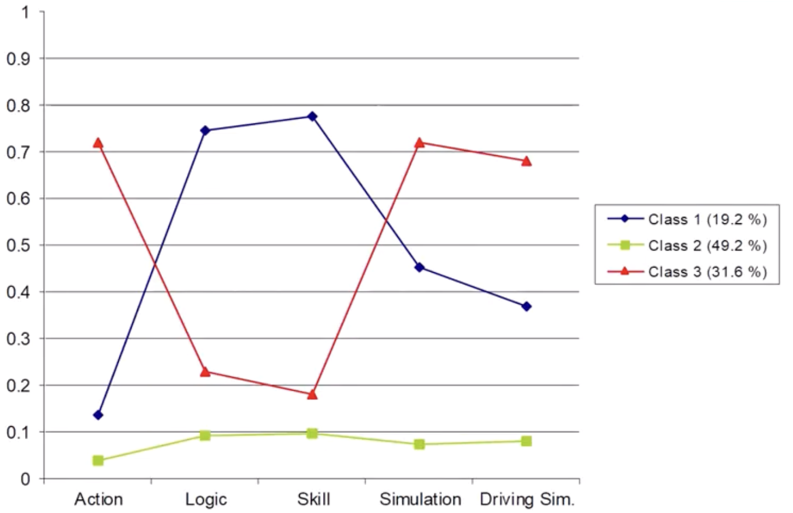

**Capítulo 1: Introduction to LCA**
hello and welcome to this video on what is Laten class analysis my name is Christian Geer I'm an instructor with Quant fish and on this channel I present
weekly statistics tutorials I usually talk about multivariate statistical methods including factor analysis structural equation modeling multi-level
analysis and lateen class analysis if this is something that interests you then please consider subscribing to this channel also don't forget to check out
the description for additional resources including workshops that I offer through Quant fish in this video I want to provide a gentle

**Capítulo 2: Defining latent class models**
introduction to latent class analysis and explain what latent class analysis is about so let's get started what is
Laten class analysis Laten class analysis could be thought of as a latent variable model similar to factor
analysis and so in this path diagram which looks like a single Factor model we have a set of indicators in this case
binary items dichotomous items that measure computer game preference so the question that um individuals here were
asked was do you play this type of computer game for example action games loog logic games skill training games
and others and so individuals were asked to answer yes or no yes I play this game no I don't play this game and the idea
is to figure out whether there are spe specific types of individuals who have a
preference for specific type types of computer games so the idea here is to extract a latent variable that
represents computer game preference unlike a factor and factor analysis the latent variable and latent class
analysis is also a categorical variable meaning it is not a continuous factor a
dimension that is being measured but rather the values of the Laten class variable are different categories for
example players versus non-players or individuals who prefer action games as opposed to logic games so this is
something that is qualitative in nature where individuals are not necessarily ordered on a Continuum of computer game
frequency of playing but rather what matters here is the type of game that individuals um play or not and so latent class
analysis then is a latent variable model where the latent variable is categorical rather than continuous and also where
the indicators are categorical so binary or ordinal that's what classical latent
class analysis deals with binary or ordinal indicator variables items and
also categorical latent variables we can put put latent class analysis in the

**Capítulo 3: LCA in context**
broader context of latent variable models to see how it compares to other types of latent variable models and so
uh what is useful here is to look at the latent and observed variables and their scale level so when we have uh observed
variables that are categorical and our latent variables are also categorical then we have LCA here shown in green
when we have indic variables that are continuous and the latent variables are categorical then we call this type of
analysis latent profile analysis although it also deals with latent classes so the latent variables are also
latent classes in the same way as in classical LCA with categorical indicator variables but the indicator variables in
latent profile analysis are continuous and so as a result what we are modeling for The observed variables is a little
bit different than what is being modeled in LCA but the idea is the same on the other hand we have latent variable
models that deal with continuous latent variables and depending on whether they use categorical indicator variables or
continuous indicator variables we either have item response Theory models which deal primarily with categorical binary
or ordinal indicator variables or we have structurally equ ation modeling and factor analysis which deal primarily
with continuous variables although there are also estimation methods in factor
analysis and sem that can handle binary and ordinal variable so you can see that
latent class analysis fits right in to the set of latent variable models and the characteristic feature of LCA is
that the latent variables are not continuous but rather that they are categorical we can also think of Laton
class analysis as a mixture distribution Model A mixture distribution model is a statistical model that aims to find

**Capítulo 4: Mixture models and data**
homogeneous subgroups in a population similar to Cluster analysis now cluster analysis is not a latent variable model
but it has a similar goal where we try to unmix a heterogeneous population that consists of qualitative complet
different subgroups that should be so to say separated or that we might be interested in separating to find out
what characteristics these different typologies or this different these different groups have and so make sure
distribution models in general allow us to estimate different groups from the population where the groups are
homogeneous and where there are differences qualitative differen between those
groups furthermore latent class analysis could also be seen as a data reduction technique similar to exploratory factor
analysis and the idea here is that with our categorical items we have a whole set of response patterns so you can see

**Capítulo 5: Exploratory LCA example**
here response patterns printed from an LCA program specifically here M plus was used to estimate a Laten class analysis
and you can see that we have across these five items here that were considered a total of 31 different
patterns that were observed with zeros and ones those were binary items where zero indicated I do not play this type
of computer game and one indicated I do play this type of computer game and so then we have all these different
patterns and now uh when you look at them and the pattern frequencies then it is very difficult often times to make
ense of all the data because 31 different patterns considering all those in a statistical analysis would be a lot
and so we would like to reduce this information down to just a few prototypical patterns particularly
because some of these patterns here are not really different from one another they differ merely due to measurement
error so there are some differences in these patterns that can be explained simply by random noise random measurement error and latent class
analysis as a latent variable model allows us to work with variables that are corrected for measurement error the
latent variables consider so say unreliability in the observed item response patterns and allow us to take
measurement error into account and so this is another important goal of Laten class analysis in particular exploratory
Laten class analysis when we have a larger set of items to reduce the information that is contained in the
many response patterns that you may observe for these items and I'll show you an example shortly where those 31
different patterns were R reduced down to three different types so here you can see a three class solution for the
computer game items and you can see that that um summarizes the patterns a lot
more neatly so now you no longer have to look at 31 different response patterns but rather you only look at three
different response profiles from those three classes that were extracted here how are the classes being extracted it

**Capítulo 6: Interpreting LCA results**

works in a similar way as an exploratory factor analysis where when it's a purely exploratory study where you don't have a
hypothesis about the number of classes you would go ahead and you would extract solution with different numbers of latent classes and you would compare the
fit of these models for example with information criteria such as the basian information criteria on Bic also there
are statistical tests um to compare the number of classes Ki Square difference tests with bootstrapping so there are
different methods that allow us to statistically compare Solutions with different numbers of classes to find the
right solution and we would also compare the profiles that we find for different numbers of classes to see which solution
makes the most sense so here the uh conclusion was that a three class solution would be best and you can see
that what um is the output of a latent class analysis are these profiles now what do these profiles show they show
so-called conditional response probabilities for each item so the endorsement probab
given membership in a specific class and you can see for example that class one is one where the probabilities are low
for action and simulation games or at least relatively low and they are relatively high for logic and skill
games so those probabilities here above s and so we would interpret class one as a logic and skill player
class the um class two is one with low probabilities on all items so this would
be interpreted as a non-player class because their probability of endorsing any of the
computer games is below 0.1 so less than 10% so those will be interpreted as
non-players and class three shows the opposite pattern of class one where those individuals reported that they do
play action and simulation games but that they do not play logic and skill games very often so it's it's kind of like a mirror image of class one which
is interesting and so you can see that clearly these classes are qualitatively different here there's not really a
quantitative difference other than that class 2 doesn't play any game at all but then between class one and class three
there's really a qualitative difference U it matters so say what types of games we are looking at so that's one type of
parameter that lat class analysis estimates are those conditional response probabilities for each item in each
class that's the parameter type number one in LCA and the parameter type number two that is estimated in LCA are the
class sizes because we also want to know what is the probability that a randomly selected individual is in class one two
or three and so those are given here in the legend where you can see the percentage for each class class one we in class one
we had about 19% in class 2 about 50% and class three about 32% you can see that these percentages
add up to 100% so according to Laton class announces everybody has to be in
one and only one Laten class so the classes are exhaustive and mutually exclusive you cannot be in more than one
class and you have to be in one of the three classes that's the idea so then it's important that you extract enough

**Capítulo 7: Goals and conclusion**
classes to where everybody can be in a meaningful class so to say where the model provides a good fit to the data so
you can see that this is a much more compact solution compared to looking at 31 different response patterns now
individuals are assigned to one of three classes the classes have a clear interpretation we have reduced data down
13:0013 minutosto three meaningful groups that differ qualitatively with regard to these
computer games so this is so say the key idea in Laden class analysis to find a
fitting model determine the number of classes and then estimate those conditional response probabilities as
well as the latent class sizes the class size parameter and then what we can also do is we can estimate individual most
likely latent class membership based on those parameters and based on their observed response pattern and so then
each individual can be looked at in terms of which probability is highest so for which class do these individuals
have the highest probability of being a member in and then we can assign people to their most likely class and not only could we assign individuals to their
most likely class but we could also see how likely it is do you have a 70% chance of being in your most likely
class or is the chance 90% so there's also so say a reliability measure for the class assignment at the individual
level where you can see so say how reliably individuals are classified and you could look at the average class
assignment probabilities as well to determine overall reliability of your classification
model so in some the goals of LCA are to study qualitative differences between individuals to determine latent
typologies to reduce data that is contained in item response patterns to determine the number and the nature of
the latent classes as well as their relative sizes to classify individuals into their most likely latent class and
another goal could be to relate the latent classes to external variables or or Co variat so you could take a look at for example are there gender differences
in computer game preference are there other classes related to age are they related to other variables that can be
studied in latent class analysis with co-variants if you want to learn more about Laten class analysis and how it is
actually done feel free to check out additional videos on this channel where I show how Laten class analysis is done
in the M plus software also check out the description for LCA and latent profile analysis workshops that I teach
through Quant fish don't forget to subscribe to this Channel and I'll see you next time
